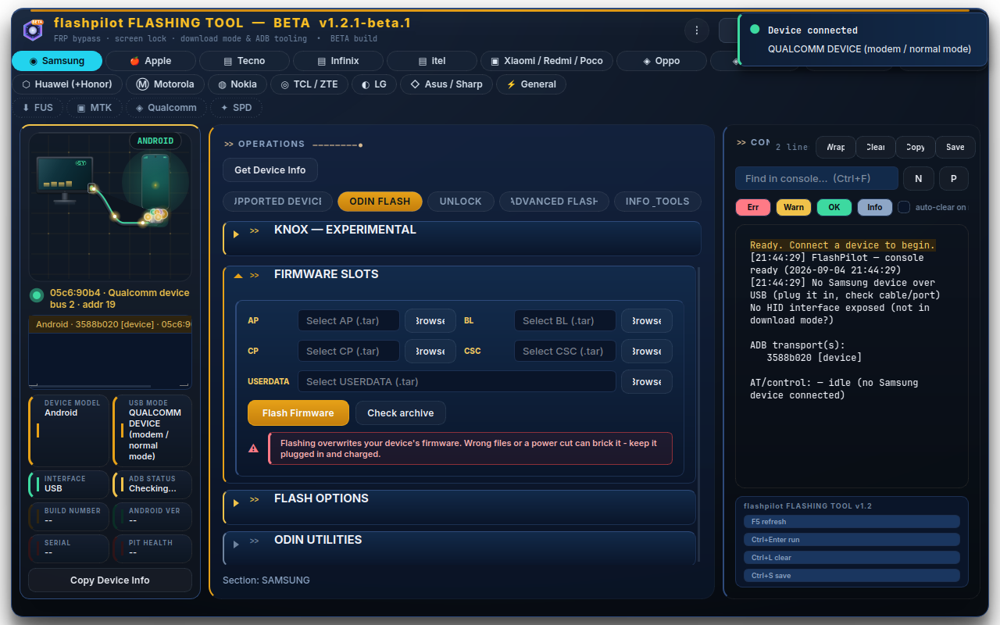
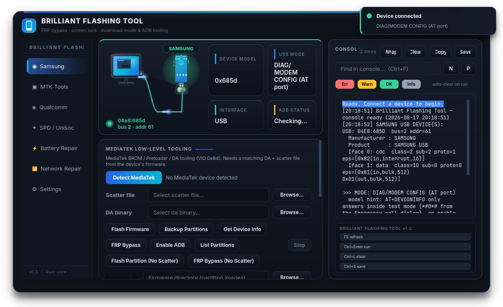
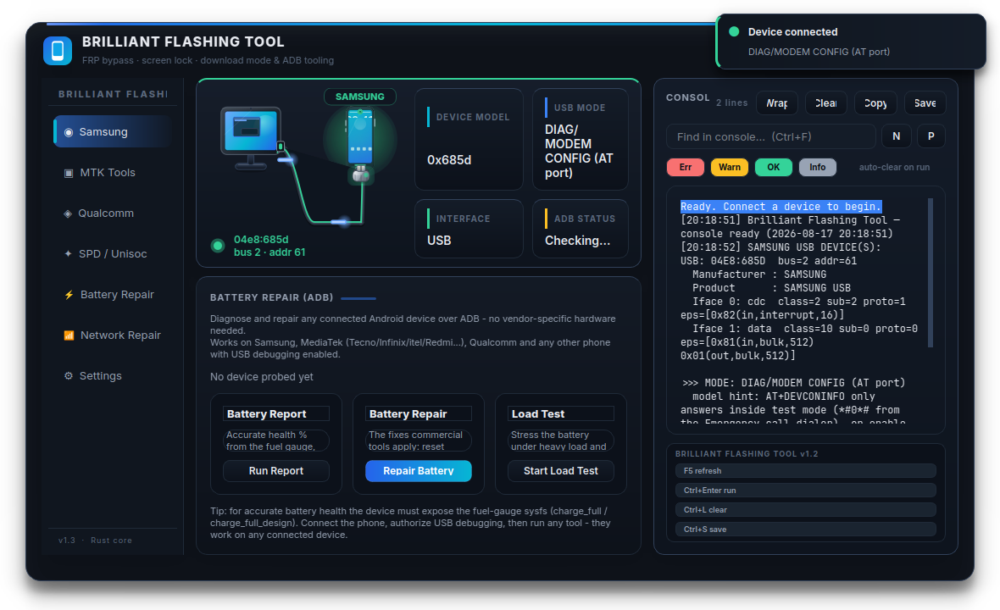
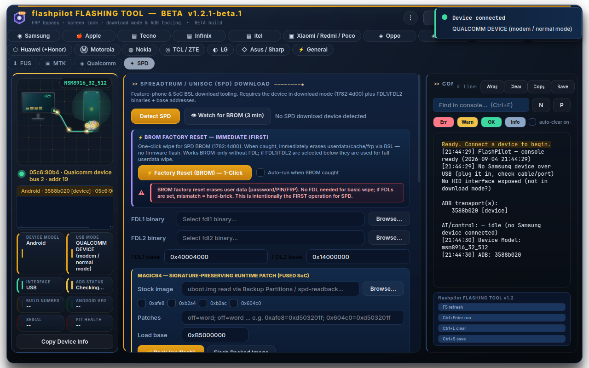

# 🔧 FlashPilot

Language switcher: [English](../../README.md) · [Français](../fr/README.md) · [Español](../es/README.md) · [Deutsch](../de/README.md) · [简体中文](../zh/README.md) · [Русский](../ru/README.md) · [Português](../pt/README.md) · **日本語** · [العربية](../ar/README.md) · [हिन्दी](../hi/README.md) · [Türkçe](../tr/README.md)

> English is the canonical source. This page is a translation; help wanted — see [`../TRANSLATION.md`](../TRANSLATION.md).

> **Linux 向けオープンソースの Samsung ファームウェア書き込み・修復ワークベンチ — Odin / Heimdall の代替として、Galaxy 端末（Download/Odin モード）、MediaTek（BROM/DA）、Qualcomm（EDL）、Spreadtrum/UNISOC 端末を書き込みます。**

**検索キーワード:** Samsung flashing tool · Odin alternative · Android firmware flashing Linux · Heimdall GUI · Galaxy phone repair · MTK BROM flash · Qualcomm EDL · FRP unlock · UNISOC flashing · device firmware tool · mobile repair · Android bootloader · USB flashing · Linux flashing suite · proprietary tool alternative

[](https://www.rust-lang.org)
[](https://www.python.org)
[](https://www.riverbankcomputing.com/software/pyqt/)
[](../../LICENSE)
[](CONTRIBUTING.md)
[](https://github.com/Legendary-Brilliantforous/flashpilot/actions)
[](https://github.com/Legendary-Brilliantforous/flashpilot/issues?q=is%3Aissue+is%3Aopen+label%3A%22good+first+issue%22)
[](https://github.com/Legendary-Brilliantforous/flashpilot/graphs/contributors)

**これは何?** 有料 Windows 書き込みスイートの Linux ネイティブ版 — **Samsung、MediaTek、Qualcomm、Spreadtrum/UNISOC 端末** の Bootloader と直接やり取りする単一の統合ツールです。リバースエンジニアリングしたプロトコル + Rust のネイティブ性能 + 美しい PyQt6 GUI = Odin、Heimdall、高価な商用ツールのオープンソース代替。

---

## ✨ なぜこのプロジェクトが重要か

Android 修復の世界は、クローズドで Windows 限定の商用ツールで成り立っています。そのプロトコルは少数のハッカーによってリバースエンジニアリングされているものの、その知識の多くは有料スイート内に閉じ込められているか、フォーラムに不完全な形で散らばっています。

**これが私たちの答えです。** こうしたリバースエンジニアリングされたプロトコルを、誰でも読めて・実行できて・拡張できて・自分の書き込みスイートとして出荷できる、クリーンで監査可能な MIT ライセンスのコードベースに変えます。

| 商用ツール | Windows 限定、クローズドソース | このプロジェクト |
|---|---|---|
| Odin / Smart Switch | Windows、GUI のみ | オープンソース Odin プロトコル（Rust、ネイティブ）+ PIT ツール |
| MTK 書き込みツール | Windows、クローズド DA | MTK BROM/DA 書き込み・バックアップ（scatter + GPT） |
| Qualcomm EDL ツール | Windows | Sahara + Firehose プロトコル実装 |
| SPD/UNISOC ツール | Windows | クリーンルーム BSL ダウンロード実装 |
| FRP / ロックツール | 有料、グレーマーケット | 透明な ADB + ダウンロードモードのフロー、MDM アンロック |

---

## 🚀 ハイライト — 1.2.1 Stable（0 warnings）

- **9 つのトランスポートモード** — ADB、MTP、Samsung Download モード、Samsung BROM、MTK、MTK BROM、Fastboot、Qualcomm EDL、SPD。
- **13 のジョブカテゴリ** — Flash Firmware、Remove FRP、Remove Screen Lock、Remove MDM、Unlock Carrier、Read Device Info、Detect Devices、Reboot、Repair Settings、およびチップ別 EXPERIMENTAL：Knox / Warranty（Samsung）、QCN / Modem（Qualcomm）、IMEI Repair / Change（MTK/SPD/Qualcomm）、eMMC / UFS。
- **マルチデバイス** — 複数の電話を接続可能：接続バーにそれぞれが列挙され、各操作は対象の電話を尋ねます（一致が1台なら静かに実行）、異なる電話は並列に操作を実行できます（1台あたり1操作、STOP は全台にブロードキャスト）。
- **Rust コア（`flashpilot-bridge`、約 9.3k LOC）— 0 件の `cargo check` 警告** — *vendored libusb* による生 USB（システム依存なし）、実プロトコル実装（+ 18 本のデッドパス配線、ltcg trim -80KB）。
  - **Samsung**: リバースエンジニアリングした Odin セッションプロトコル（Heimdall ベース）、HID ダウンロードモードペイロード、PIT の read/write/flash — AT `Context` を保持、`EndpointConfig` チャンキング。
  - **MediaTek**: BROM / preloader / DA ハンドシェイク、scatter & GPT、BROM エクスプロイト、SLA キー — `ProgressReporter` による実 %。
  - **Qualcomm**: `ProtocolError` Sahara + Firehose `QcomDeviceInfo` を `Duration` タイムアウト経由で配線。
  - **SPD/UNISOC**: クリーンルーム BSL — `BSL_CMD/REP`、`iface`、`flush/read_flash/chip_uid/power_off` すべて配線。
  - **MTP**、**AT コマンド**、完全な **ADB** 配管も。
- **スタジオ級 GUI** — フレームレス半透明ウィンドウ、10 種のアクセントテーマ、アニメーション付きケーブル/ステータスシーン、ライブコンソール。
  - **ブランドアイコンと独自ボタン背景** — 鮮明なブランドアイコン（Samsung Ⓢ、Apple 赤リンゴ 🍎、Motorola Ⓜ、LG Ⓛ など）と、上部チップバーの各 OEM ボタンへの tailored ブランド背景色。
  - **Motorola と Apple の横並びビュー** — モデル操作ボードは既定でクリーンな横並びタブレイアウトになります。
  - **マイクロインタラクションとグラスモーフィズム** — 滑らかな 160ms ページ切り替えフェードイン、等幅メタデータバッジタイポグラフィ（`Consolas`、`Monaco`）、強化されたグラスモーフィックカードボーダー。
  - **大きめ中央ダイアログ（620px、ドラッグ可能、✕）** — ベータゲート + stable `UPDATE/AHEAD/PATCH` + フラッシュ/FRP 確認、チップ色 `MTK amber` `QCOM red` `SPD violet` `SAMSUNG blue`、高コントラスト文字。
  - **チップ別 EXPERIMENTAL コラプシブル** — Knox（Samsung）、QCN/IMEI（Qualcomm）、IMEI（MTK/SPD）：黄色バナー、毎回の所有権チェックボックス、IMEI 変更の `I UNDERSTAND` タイプ確認、監査ログ。
  - **⏹ STOP** タイトルバーで実行中の全操作を停止；デバイス別ロックで他の電話は使い続けられます。

---

## 📸 スクリーンショット

| Samsung ops | MediaTek workbench | Battery repair | SPD download |
|---|---|---|---|
|  |  |  |  |

---

## 🧩 機能マトリクス

| 機能 | Samsung | MediaTek | Qualcomm | SPD/UNISOC | Any ADB |
|---|---|---|---|---|---|
| 検出 / 情報 | ✅ | ✅ (+ crash preloader→BROM) | ✅ (Sahara) | ✅ | ✅ |
| ファームウェア書き込み | ✅ (Odin, ネイティブ Rust) | ✅ (scatter + GPT) | ✅ (Firehose) | ✅ (FDL/regions) | — |
| パーティションバックアップ | ✅ (EFS) | ✅ | ✅ | ✅ | — |
| FRP バイパス | ✅ (ADB + download) | ✅ | ✅ (EDL) | ✅ | ✅ |
| 画面ロック解除 | ✅ | ✅ | ✅ (EDL) | — | ✅ |
| MDM アンロック | ✅ (ADB, QR, recovery) | — | — | — | — |
| Knox 保証/バイパス (EXPERIMENTAL) | ✅ | — | — | — | — |
| QCN バックアップ/復元 + IMEI 修復/変更 (EXPERIMENTAL) | — | ✅ (NVRAM) | ✅ (NV 550/682) | ✅ (BSL NV) | — |
| パーティションツール | ✅ (PIT) | ✅ (GPT) | ✅ | ✅ (PAC extract/pack) | — |
| ローレベルエクスプロイト | ✅ (HID/BROM) | ✅ (BROM exploit、SLA) | ✅ (Sahara) | ✅ (BSL) | — |
| バッテリー / ネットワーク修復 | — | — | — | — | ✅ |

> 💡 **Battery** と **Network** セクションは USB デバッグがある *どの* Android 端末でも動作します — ベンダーハードウェアは不要です。

---

## 🖥️ GUI

フレームレス半透明、角丸カードのウィンドウ。上部にライブ **接続バナー**（コンピュータ → ケーブル → 電話シーン、アニメーションされたデータパルス）、左に **ナビレール**、右に **コンソール/ログパネル**。

- **接続バー** — ライブデバイス一覧（電話ごとに1行：モデル · シリアル · トランスポート）；行をクリックして検査。複数一致時は操作ボタンが対象電話を尋ねます。
- **Samsung** — Samsung ハブサブタブ：`ODIN FLASH · UNLOCK · ADVANCED FLASH · INFO & TOOLS`、ファームウェアスロット（AP/BL/CP/CSC/USERDATA）、Odin ユーティリティ、`KNOX — EXPERIMENTAL` コラプシブル。
- **MediaTek / Qualcomm / SPD** — 専用ワークベンチ、ネイティブローレベルツール付き（scatter/DA + crash-to-BROM、programmer/XML + QCN/IMEI、FDL バイナリ + ベースアドレス + IMEI）、各自 `— EXPERIMENTAL` コラプシブル。
- **Battery** — フューエルゲージ健康度 %、温度/電圧/電流、消費上位；ワンクリック修復。
- **Network** — SIM 状態、データ/Wi-Fi フラグ、DNS モード；無線リセット＆再登録。
- **Settings** — 自動スキャン間隔、既定パス、コンソール自動クリア、10 種アクセントテーマ、アニメーション（shake/rubber/cable/bubble トグル）、ウィンドウグロー、エンジンステータス、アプリ内 `cargo build`。

**ショートカット:** `F5` 再スキャン · `Ctrl+Enter` 実行 · `Ctrl+L` コンソールクリア · `Ctrl+S` ログ保存 · `Ctrl+F` 検索。

---

## 📦 クイックスタート

**要件:** Rust ツールチェーン、Python 3.10+、Linux デスクトップ。以上 — libusb は vendored です。

```bash
# 1. Rust ベースの bridge をビルド（初回ビルドは libusb をソースからコンパイル）
cargo build --release

# 2. （推奨）udev ルールを入れて電話に sudo を不要にする
sudo bash root/setup-usb.sh

# 3. Python 環境
python3 -m venv .venv
.venv/bin/pip install -r requirements.txt

# 4. 起動
.venv/bin/python -m python.main        # or: python3 main.py
```

Samsung ダウンロードモード書き込みはネイティブ（Rust Odin プロトコル）です — 独自の odin4 バイナリは取得・同梱・必要としません。Samsung コンボファームウェアは Samsung 公式サポートページまたは信頼できるファームウェアアーカイブから入手してください。

---

## 🖥️ プラットフォームサポート — あなたの声が欲しい

**Linux はサポート対象プラットフォームです。** FlashPilot は意図的に *Windows 限定書き込みスイートへの Linux ネイティブな回答* — 開発・テスト・リリースは Linux を対象とし、それは変わりません。

**Windows / macOS は現時点で未サポート** — 実用的理由から：

- Windows USB は電話モードごとのドライバ地獄（Zadig/WinUSB、QDLoader、Samsung ドライバ同士の競合）；「端末未検出」レポートのほとんどは遠隔デバッグ不可。
- macOS は修理店需要がほぼゼロなのに署名/公証のオーバーヘッドを伴います。
- スタック *自体は* 移植可能（Rust + rusb、Python、Qt）、そのためこれは技術的不可能性ではなく保守判断です。

**しかしこれは未決の問いであり、結論ではありません。** Windows/macOS サポートが欲しい — あるいは Linux のみを永久に主張したい — のなら知らせてください：

- 💬 ユースケース（修理店？ラボ？どの OS？どの電話？）を添えて **[Discussion](https://github.com/Legendary-Brilliantforous/flashpilot/discussions)** を開いてください。
- 🔧 コードこそが雄弁：計画は `python/core/platform.py` 抽象（`open_file_manager()`、`detach_kernel_drivers()`、`usb_device_path()`、`needs_udev_setup()`）、Linux のみバックエンドなので、移植は fork ではなく追加 PR になります。その方向の PR は今は歓迎。
- 🎨 関連：貢献者は PyQt6（GPLv3）に対する **PySide6**（LGPL、この MIT プロジェクトとライセンス互換）を提案。同じ Discussion で意見を — 移行は機械的だが GUI スモークテストの網羅が先に必要。

貢献者の声なしに決断はされません。ぜひ参加してください。

### CLI / bridge

```bash
./target/release/flashpilot-bridge detect          # all USB + Samsung filter (JSON)
./target/release/flashpilot-bridge fastboot-devices  # USB devices with a fastboot interface (JSON)
./target/release/flashpilot-bridge fastboot-cmd 22b8:2e80@2:16 20000 getvar securestate  # one raw fastboot command
./target/release/flashpilot-bridge mtk-detect      # MediaTek BROM (0e8d:0003) / preloader (0e8d:2000) / DA
./target/release/flashpilot-bridge mtk-crash-brom <bus:addr>  # crash preloader into held BROM
./target/release/flashpilot-bridge qcom-detect     # Qualcomm EDL
./target/release/flashpilot-bridge spd-detect      # Spreadtrum/UNISOC (VID 0x1782)
./target/release/flashpilot-bridge odin-pit 04e8:xxxx@bus:addr  # read PIT
./target/release/flashpilot-bridge at-send <t> ATI # AT over CDC ACM
./target/release/flashpilot-bridge adb-devices     # adb devices -l as JSON
```

---

## 📁 リポジトリレイアウト

```
flashpilot/
├── src/                      # Rust bridge (~13k LOC) — ALL flows live here
│   ├── main.rs               #   command-line entry (80+ commands) + flow-run dispatch
│   ├── flows.rs              #   THE registry: FLOWS / JOBS / MODES (flow! macro, ~280 rows)
│   ├── usb/                  #   USB enumeration / interfaces / filtering (mod.rs + filtering.rs)
│   ├── devices.rs            #   merged USB+ADB device rows
│   ├── sam_download.rs       #   Samsung Download/Odin protocol (odin-* commands)
│   ├── mtk.rs mtk_da.rs      #   MediaTek BROM/DA flashing
│   ├── mtk_exploit.rs        #   BROM exploits (bypass/kamakiri2/crash-to-BROM)
│   ├── mtk_sla.rs            #   MediaTek SLA key handling
│   ├── qualcomm/             #   Sahara + Firehose + GPT (EDL)
│   ├── spd.rs                #   Spreadtrum/UNISOC BSL protocol (+ PAC)
│   ├── pac.rs                #   SPD PAC extract/pack
│   ├── pit.rs                #   Samsung PIT parser
│   ├── mtp.rs at.rs adb.rs   #   MTP, AT command, ADB plumbing
│   ├── fastboot.rs           #   native fastboot transport
│   ├── moto_flash.rs         #   Motorola staged fastboot FRP
│   ├── apple.rs              #   Apple usbmuxd/lockdown
│   ├── hid.rs bulk.rs        #   HID + bulk helpers
│   ├── fwtar.rs sparse.rs    #   firmware tar + sparse handling
│   ├── imgtools.rs           #   boot/vbmeta surgery
│   ├── hostinfo.rs           #   host eMMC/UFS health
│   ├── sam_*.rs              #   Samsung helpers (errors/setup)
│   └── config.rs error.rs util.rs
├── main.py                   # app entry (venv-safe launcher → python.gui.qt_app)
├── python/
│   ├── core/
│   │   ├── core.py           #   thin shim: mirrors Rust FLOWS/JOBS/MODES via bridge.flow_list()
│   │   ├── frp.py            #   FRP-only re-export surface (name == responsibility)
│   │   ├── devices.py        #   multi-device identity: stable keys, list, resolve, transport mapping
│   │   ├── bridge.py         #   talks to the Rust binary (+ per-key cancel)
│   │   ├── flow.py           #   Flow/Step primitives + cancellation
│   │   ├── jobs.py           #   FlashJob lifecycle (isolated job layer)
│   │   ├── cancel.py         #   cooperative cancellation registry
│   │   ├── mtk.py            #   MTK PIDs/stages/chips (0003=BROM, 2000=preloader)
│   │   ├── mtp.py            #   Samsung MTP/AT (multi-sequence ADB enable)
│   │   ├── pit.py pitstore.py  # Samsung PIT parser + cache
│   │   ├── adb.py            #   ADB helpers
│   │   ├── device_info.py    #   live device identity
│   │   ├── actions.py        #   action helpers
│   │   ├── experimental.py   #   per-run ack gates + audit log
│   │   ├── fus.py            #   Samsung FUS helpers
│   │   └── (no flows/ dir)   #   flows live in src/flows.rs; Python only delegates
│   └── gui/
│       ├── qt_app.py         #   the PyQt6 studio (~12k LOC)
│       ├── devices.py        #   brand→model→action drill-down pages
│       ├── nav.py            #   nav rail + OEM chip bar
│       ├── theme.py          #   tokens (accent vs focus_ring/sel_border) + QSS
│       ├── animations.py     #   Motion (shake/rubber serialized, no stuck state)
│       ├── toast.py          #   toast notifications
│       └── supported_devices.json  #   brand/model/chip research table
├── operations/               # per-operation docs + research (frp/mdm/flashing/…)
├── docs/                     # screenshots (fresh) + logo
├── root/                     # udev rules + setup-usb.sh
├── scripts/                  # dump-connected.sh, validate_mtp_at.py
├── INDEX.md CHANGELOG.md     # engineering index + release changelog
└── tests/                    # pytest suite (flow, MTK, PIT, odin safety, devices…)
```

---

## 🧑‍💻 コントリビュート

**このプロジェクトはあなたと一緒ならもっと良くなります。** メンテナ、プロトコルハッカー、GUI デザイナー、ドキュメントライター、テスターを求めています。

- **[CONTRIBUTING.md](CONTRIBUTING.md)** — 始めるために必要なすべて。
- **[`good first issue`](https://github.com/Legendary-Brilliantforous/flashpilot/issues?q=is%3Aissue+is%3Aopen+label%3A%22good+first+issue%22) ラベルから** — キュレートされた初心者向けタスク。
- **[バグレポート](https://github.com/Legendary-Brilliantforous/flashpilot/issues/new?labels=bug&template=bug_report.yml)** / **[機能リクエスト](https://github.com/Legendary-Brilliantforous/flashpilot/issues/new?labels=enhancement&template=feature_request.yml)** テンプレートを使用。
- **初心者向けタスク** — `src/flows.rs` の各フロー行がチャンス：`flow!(...)` 行を追加、コマンドシーケンスを調整、新しいデバイスコンボを配線。Python は `bridge.flow_list()` で自動検出します。
- **フローフレームワーク（`src/flows.rs`）は非常にシンプル** — 新しいメソッドは1行：
  ```rust
  flow!("my_method", "My method", "Read Device Info", "ADB"),
  ```
  GUI に自動表示。これが全貢献ループ：**フロー行を書けば、機能を届けられる。**
- **マルチデバイスルール** — 「その」デバイスをつかみとらない；`key=None`（ambient スコープ）を受け取り、それによるフィルタ。`python/core/devices.py` と `CONTRIBUTING.md` を参照。
- **命名規則** — ジョブは動詞先頭（`Remove FRP`、`FRP bypass` ではない）；フローキーは短い snake_case（`FLOWS` に `flow_` プレフィクスなし）；MTK PIDs は `0003`=BROM / `2000`=preloader（mtkclient 慣例 — 入れ替えないこと）。

**助けを欲しがっているアイデア:**
- フロー表への新規デバイスモデル / ファームウェアコンボ。
- MediaTek DA バリアント、scatter/GPT クセ。
- Qualcomm rawprogram & patch XML エッジケース。
- Android バージョン別追加 FRP / ロック解除メソッド。
- パッケージング（Flatpak、AppImage、AUR、`cargo` + `pip`）、CI、ユニットテスト。
- 追加の ODIN プロトコル、eMMC/UFS ツーリング、iCloud 隣接・EDL ユーティリティ。
- 翻訳、テーマ、アクセシビリティ。

---

## 🛡️ 安全性と合法性

このツールはブートローダーと直接対話し、誤用するとデータ消失や端末ブリックの恐れがあります。

- **所有、またはサービスを認可された端末でのみ**使用（顧客端末を同意のもと扱う修理店を含む）。
- 画面の警告を常に読み、フラッシュ前に **パーティションをバックアップ** してください。
- 所有していない端末で FRP/MDM をバイパスすると、**あなたの管轄で違法になる場合があります** — 使用方法はあなたの責任です。
- FlashPilot は操作が必要とするプロトコルペイロード（MTK DA/BROM ペイロード、Qualcomm firehose プログラマー、Unisoc FDL1/FDL2、Samsung ブートローダー）をバンドルします — 商用書き込みスイートと同じ方式です。特定電話用ファームウェアイメージは引き続きユーザーまたはベンダー提供です。

---

## 📄 ライセンス

MIT — [LICENSE](../../LICENSE) を参照。Odin プロトコル定数は Heimdall プロジェクト（MIT）由来、SPD BSL 参照はクリーンルームプロトコル記述（spd_cmd.h / Opus-Spreadtrum docs）由来。

---

**このリポジトリに Star ⭐、issue オープン、PR 送信 — Linux の最高のオープン書き込みスイートを一緒に作りましょう。**